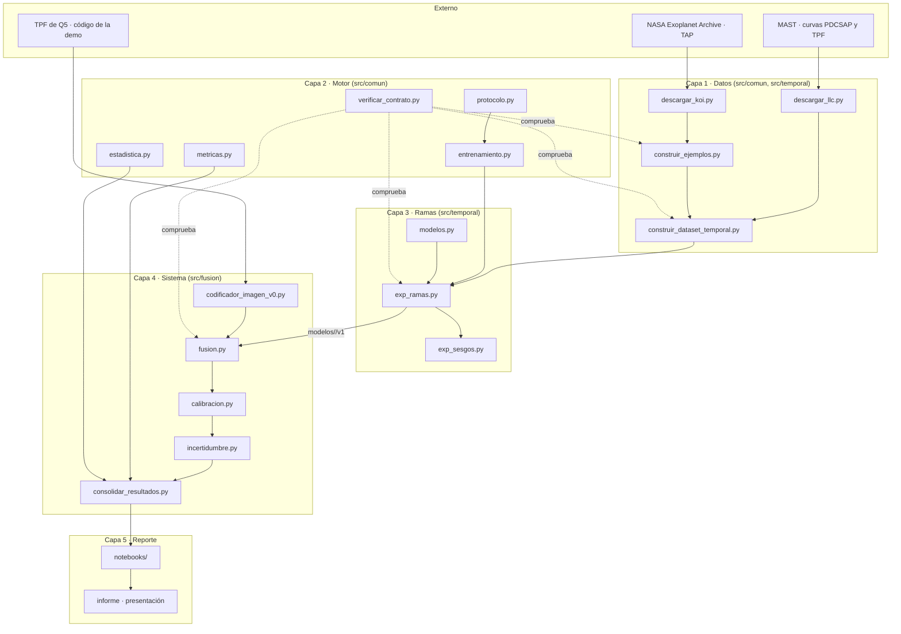
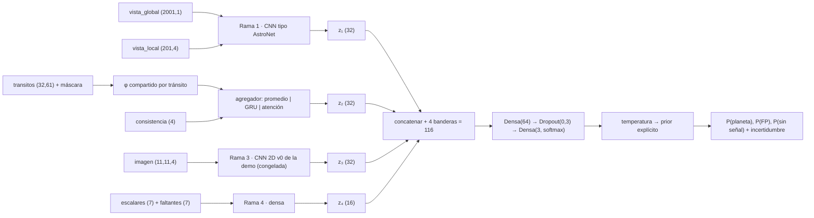

# Arquitectura del repositorio

Proyecto del curso de Deep Learning: *Clasificación calibrada de señales de tránsito de Kepler con una red multirrama y un codificador por tránsito con atención* (título provisional).

Este documento dice **dónde va cada cosa y qué puede depender de qué**. El qué y el cuándo están en `docs/planeacion/04_plan_ejecucion_deep_learning.md`; el detalle de cada funcionalidad, en `specs/`.

---

## 1. Vista de capas



**Excepción declarada:** `02_experimentacion_hiperparametros.ipynb` sí entrena (una búsqueda pequeña en `resultados/dl/busqueda_demo/`, fuera de git); `informe_dl.ipynb` y `01_exploracion_datos.ipynb` no entrenan.

**Regla de dependencias:** una capa solo importa de capas con número menor. `src/comun` no importa de `src/temporal` ni de `src/fusion`. `src/temporal` no importa de `src/fusion`. Los notebooks no importan código de entrenamiento: solo leen `resultados/dl/`.

## 2. Árbol de carpetas

```
Proyecto_Final/
├── README.md                    cómo instalar y reproducir
├── CLAUDE.md                    guía para agentes de código (reglas, comandos, errores típicos)
├── pyproject.toml               paquetes (comun, temporal, fusion), pytest y ruff
├── requirements.txt             dependencias; requirements.lock.txt se genera en PT0
├── config/
│   └── protocolo.json           protocolo experimental fijo (particiones, semillas, entrenamiento, formas)
├── compartido/                  BASE COMÚN con Visión (versionada)
│   ├── ejemplos.csv             tabla maestra: una fila por id_ejemplo
│   └── manifiesto_base.json     consulta TAP, fecha, hashes, versiones
├── data/                        datos grandes, FUERA de git (salvo seleccion_demo.csv)
│   ├── seleccion_demo.csv       260 KOIs de la demo
│   ├── koi_dr25.csv             tabla DR25 descargada
│   ├── llc/                     curvas PDCSAP Q1–Q17 + manifiesto_llc.csv
│   ├── tpf/                     TPF de Q5 (solo imagen v0 y línea base de la demo)
│   ├── dataset_temporal.npz     entradas de las ramas 1, 2 y 4
│   └── dataset_demo.npz         entradas de la demo: imagen (rama 3 v0) y curva de 61 puntos (M0)
├── modelos/<rama>/v<N>/         rama ∈ {vistas, transitos, escalares, imagen}
│   ├── particion_0..4.keras     codificador hasta la capa "embedding"
│   ├── vectores_particion_0..4.npz   id_ejemplo y z para TODOS los ejemplos
│   └── manifiesto.json
├── resultados/dl/<experimento>/ pred_semilla<s>.npz, metricas.json, manifiesto.json, figuras
│   └── tablas/                  único origen de las cifras del informe
├── src/
│   ├── comun/                   capa 1 (tabla, particiones) y capa 2 (motor)
│   ├── temporal/                capa 1 (curvas) y capa 3 (ramas 1, 2, 4)
│   ├── fusion/                  capa 4
│   ├── informe/                 capa 5: lectura de resultados y figuras del notebook (no entrena)
│   └── demo/                    scripts originales de la demo, SIN modificar (referencia)
├── specs/NNN-nombre/            Spec Kit: spec.md, plan.md, tasks.md
├── tests/                       pytest; curvas sintéticas solo aquí
├── notebooks/                   01_exploracion_datos, 02_experimentacion_hiperparametros, 03_estudio_de_diseno, informe_dl
├── docs/
│   ├── ARQUITECTURA.md          este documento
│   └── planeacion/              plan de ejecución, bitácora, copia de contrato y estado
└── .specify/memory/constitution.md   principios que ninguna especificación puede violar
```

## 3. Módulos y responsabilidades

| Módulo | Capa | Responsabilidad | Estado |
|---|---|---|---|
| `comun/protocolo.py` | 2 | Cargar `config/protocolo.json`; máscaras de entrenamiento, validación interna y prueba por partición; comprobar que no hay estrellas repetidas | **Implementado y probado** |
| `comun/metricas.py` | 2 | AUC planeta vs FP, NLL, Brier, ECE (top-label y binario, con pesos), exactitud | **Implementado y probado** |
| `comun/estadistica.py` | 2 | *Bootstrap* por estrella, simple y pareado | **Implementado y probado** |
| `comun/descargar_koi.py` | 1 | Consulta TAP con columnas explícitas, hash y manifiesto | spec 001 |
| `comun/construir_ejemplos.py` | 1 | `compartido/ejemplos.csv`: etiquetas DR25, particiones, prerregistro | spec 001 |
| `comun/lineas_base_tabulares.py` | 2 | S3-B, S3-C y `koi_score` como comparador | spec 001 |
| `comun/verificar_contrato.py` | 2 | Comprobaciones del contrato §8 y lista blanca de escalares | spec 001 |
| `comun/entrenamiento.py` | 2 | `entrenar_cv`, exportación de codificadores y vectores, pruebas de cordura | spec 003 |
| `temporal/descargar_llc.py` | 1 | Descarga reanudable de PDCSAP Q1–Q17 | spec 002 |
| `temporal/curvas.py` | 1 | Limpieza, aplanado con máscara, ruido, plegado | spec 002 |
| `temporal/construir_dataset_temporal.py` | 1 | Vistas, ventanas por tránsito, escalares → `.npz` | spec 002 |
| `temporal/modelos.py` | 3 | M1, M1r, φ, M2p, M2g, M2a, M4 | spec 004 |
| `temporal/linea_base_demo.py` | 3 | M0: la demo con las particiones comunes | spec 004 |
| `temporal/exp_ramas.py` | 3 | E0–E2, selección del agregador, exportación v1 | spec 004 |
| `temporal/exp_sesgos.py` | 3 | E3 (permutación), E4 (menos tránsitos), E5 (pooling) | spec 004 |
| `fusion/codificador_imagen_v0.py` | 4 | Rama de imagen de la entrega (v0 de la demo, congelada) | spec 005 |
| `fusion/fusionar.py` | 4 | E6a, E6c, E7 y diagnóstico del apilado | spec 005 |
| `fusion/calibracion.py` | 4 | E8 (temperatura) y E9 (prior explícito) | spec 006 |
| `fusion/incertidumbre.py` | 4 | E10 (MC Dropout vs ensamble) y E11 (errores) | spec 006 |
| `fusion/consolidar_resultados.py` | 4 | Tablas finales y veredicto de las hipótesis | spec 007 |
| `comun/busqueda.py` | 2 | Búsqueda aleatoria: muestreo, selección anidada, resumen y tablas | spec 009 |
| `temporal/busqueda_ramas.py` | 3 | Espacios de las ramas 1, 2 y 4; guarda el modelo elegido por partición | spec 009 |
| `temporal/despliegue.py` | 3 | Cargar un modelo guardado (verifica la huella) y predecir | spec 009 |
| `fusion/busqueda_cabeza.py` | 4 | Búsqueda de la cabeza de fusión | spec 009 |
| `comun/estudio.py`, `temporal/estudio_diseno.py` | 2–3 | Estudio de decisiones de diseño (una variante cambia una cosa) y su confirmación con 3 semillas | spec 010 |
| `temporal/e4_menos_transitos.py` | 3 | E4: AUC por agregador con menos tránsitos en prueba | spec 010 |
| `fusion/sistema.py` | 4 | Sistema conjunto: codificadores → cabeza → temperatura → prior; `empaquetar` y `Sistema.responder` | spec 011 |
| `fusion/experimental_v2.py` | 4 | Copia experimental del sistema con la rama 1 mejorada; no toca el resultado principal | spec 013 |
| `fusion/auditoria.py` | 4 | Auditoría automática (fugas, particiones, datos, reproducibilidad, cifras, redacción) | spec 011 |
| `informe/diseno.py` | 5 | Figuras del notebook 03 | spec 010 |
| `informe/exploracion.py`, `informe/experimentacion.py` | 5 | Figuras de los notebooks exploratorios | spec 009 |
| `informe/datos.py` | 5 | Carga única de dataset, tablas y predicciones (`Resultados`) | spec 007 |
| `informe/graficos.py` | 5 | Gráfico de intervalos, diagrama de confiabilidad, vista de una señal | spec 007 |
| `informe/secciones.py` | 5 | Una función por figura del notebook | spec 007 |
| `informe/interactivo.py` | 5 | Controles (`ipywidgets`) con modo fijo y explorador de señales | spec 007 |

## 4. Flujo de datos y formatos

| Artefacto | Productor | Consumidor | Formato |
|---|---|---|---|
| `compartido/ejemplos.csv` | `construir_ejemplos.py` | todo | CSV UTF-8; columnas del contrato §3 + `fp_nt, fp_ss, fp_co, fp_ec, n_koi_en_estrella, t0_bkjd, duracion_h` |
| `data/dataset_temporal.npz` | `construir_dataset_temporal.py` | ramas 1, 2, 4 | claves del contrato §4 + `paridad_transitos`, `n_transitos_validos`, `consistencia`, `disponible_vistas`, `disponible_transitos`, `id_ejemplo` |
| `modelos/<rama>/v1/*` | `exp_ramas.py` | `fusion.py` | contrato §5 |
| `resultados/dl/<exp>/pred_semilla<s>.npz` | `entrenamiento.py` | calibración, consolidación | `id_ejemplo` (U), `particion` (int), `p_prueba` (n, 3), `p_validacion` (n, 3) y `particion_modelo_validacion` (n,): predicción hecha por el modelo de la partición en que el ejemplo es validación interna |
| `resultados/dl/tablas/*.csv` | `consolidar_resultados.py` | notebook e informe | una fila por modelo y métrica, con `estimacion, ic_inf, ic_sup, n` |

Reglas de formato:

- Todo se une por `id_ejemplo`, nunca por posición.
- Los `.npz` no contienen objetos Python: cadenas como arreglos Unicode. Se cargan con `allow_pickle=False`.
- Los arreglos de entrada no contienen NaN. Lo que falta se marca en `faltantes`, `mascara_transitos` o `disponible_*`.

## 5. Línea de comandos (orden de ejecución completo)

```bash
pip install -e . && pip install -r requirements.txt
export KERAS_BACKEND=jax            # PowerShell: $env:KERAS_BACKEND="jax"

# Capa 1 · datos
python -I src/comun/descargar_koi.py --salida data/koi_dr25.csv --manifiesto compartido/manifiesto_base.json
python -I src/comun/construir_ejemplos.py --seleccion data/seleccion_demo.csv --koi data/koi_dr25.csv --salida compartido/ejemplos.csv
python -I src/temporal/descargar_llc.py --ejemplos compartido/ejemplos.csv --destino data/llc
python -I src/temporal/construir_dataset_temporal.py --llc data/llc --ejemplos compartido/ejemplos.csv --koi data/koi_dr25.csv --salida data/dataset_temporal.npz
python -I src/comun/verificar_contrato.py --raiz .

# Capa 2–3 · líneas base y ramas
python -I src/comun/lineas_base_tabulares.py --ejemplos compartido/ejemplos.csv --koi data/koi_dr25.csv --salida resultados/dl/lineas_base_tabulares
python -I src/temporal/exp_ramas.py --dataset data/dataset_temporal.npz --ejemplos compartido/ejemplos.csv --salida resultados/dl --modelos modelos
python -I src/temporal/exp_sesgos.py --dataset data/dataset_temporal.npz --ejemplos compartido/ejemplos.csv --resultados resultados/dl

# Capa 4 · sistema
python -I src/fusion/codificador_imagen_v0.py --dataset data/dataset_demo.npz --ejemplos compartido/ejemplos.csv --salida modelos/imagen/v0
python -I src/fusion/fusion.py --modelos modelos --version-imagen v0 --ejemplos compartido/ejemplos.csv --salida resultados/dl/fusion
python -I src/fusion/calibracion.py --predicciones resultados/dl/fusion --koi data/koi_dr25.csv --salida resultados/dl/calibracion
python -I src/fusion/incertidumbre.py --modelos modelos --predicciones resultados/dl/fusion --salida resultados/dl/incertidumbre
python -I src/fusion/consolidar_resultados.py --resultados resultados/dl --salida resultados/dl/tablas

pytest -q
```

Todos los scripts usan `argparse`, aceptan `--protocolo config/protocolo.json` (valor por defecto) y escriben `manifiesto.json` junto a su salida.

## 6. Arquitectura del modelo



- Este curso construye las ramas 1, 2 y 4, la fusión y la calibración.
- La rama 3 **no es un aporte de este curso**. Para la entrega se usa el codificador v0 (código de la demo, anterior a los cursos), congelado y con un codificador por partición. El curso de Visión desarrolla esa rama por separado; los dos proyectos se unen después de las entregas.
- Cada rama se entrena sola con su propia cabeza `Dense(3)`; a la fusión solo pasa el vector `embedding`.

## 7. Estrategia de pruebas

| Nivel | Qué prueba | Dónde |
|---|---|---|
| Unitarias | Métricas contra `sklearn` y casos a mano; *bootstrap*; particiones sin solape | `tests/test_motor.py` |
| Extractor | Curvas sintéticas con una caja de profundidad conocida; alternancia par/impar; huecos | `tests/test_extractor.py` (spec 002) |
| Contrato | Formas, identificadores, lista blanca, prerregistro | `src/comun/verificar_contrato.py` |
| Cordura | Etiquetas barajadas ≈ 0,5; sobreajuste de un lote | `comun/entrenamiento.py` (spec 003) |
| Integración | Corrida completa con 20 ejemplos sintéticos y 2 épocas | `tests/test_integracion.py` (spec 003), marcada `lenta` |

Las curvas sintéticas existen solo para probar código. Nunca producen una cifra del informe.

## 8. Relación con el repositorio de la tesis y con Visión

Este repositorio es **independiente** del repositorio `Proyecto deteccion planetas` (tesis y Visión). **Para la entrega del curso no recibe nada de Visión.** La tabla describe la unión posterior, que se hace por archivos y no por código:

| Qué cruza | Dirección | Cómo se garantiza que es lo mismo |
|---|---|---|
| `compartido/ejemplos.csv` y `manifiesto_base.json` | Se construye una vez y se copia al otro repositorio | SHA-256 en el manifiesto; `verificar_contrato.py` lo compara |
| `modelos/imagen/v1/` | De Visión hacia aquí, **después de las entregas** | `manifiesto.json` del codificador y verificación de `id_ejemplo` |
| Scripts de la demo | Copia sin modificar en `src/demo/` | Se anota el commit de origen en `src/demo/ORIGEN.md` |

Hacia Visión solo viaja, si Visión quiere usarla, la base común.

## 9. Seguridad

- Descargas solo por HTTPS a `exoplanetarchive.ipac.caltech.edu`, `mast.stsci.edu` y `archive.stsci.edu`.
- `kepid` se valida como entero positivo antes de usarlo en una consulta o una ruta. Las rutas de salida se resuelven y deben quedar dentro de la carpeta indicada por argumento.
- `np.load(..., allow_pickle=False)`. `keras.saving.load_model(..., safe_mode=True)`. Los `.keras` solo vienen de este repositorio o del de Visión.
- Sin `shell=True`, sin `eval`/`exec`, sin credenciales. `python -I` al procesar archivos descargados.
- Dependencias fijadas en `requirements.lock.txt`.
